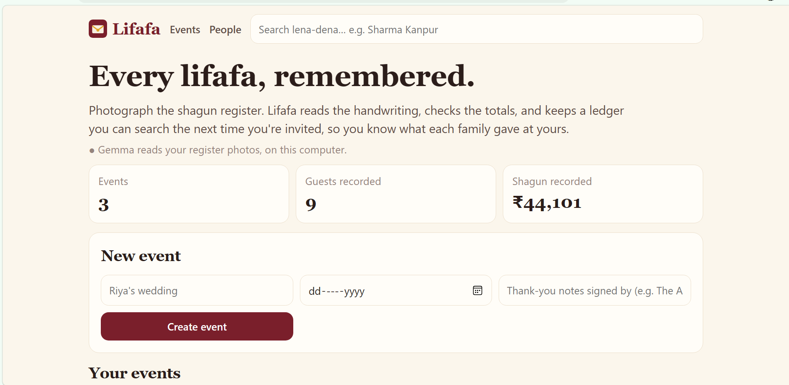
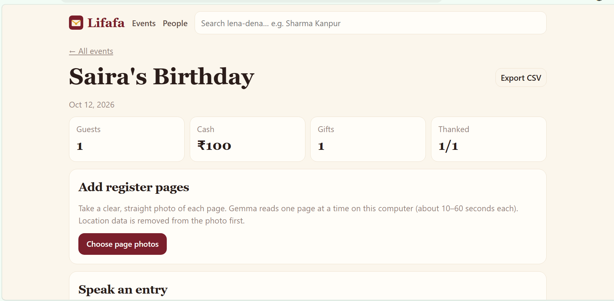
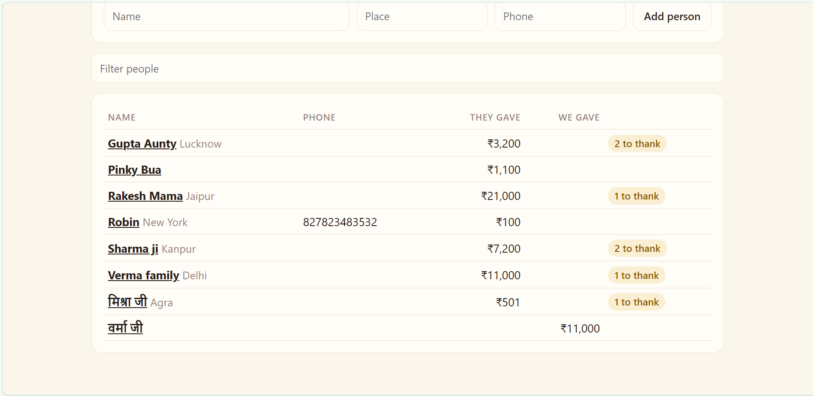
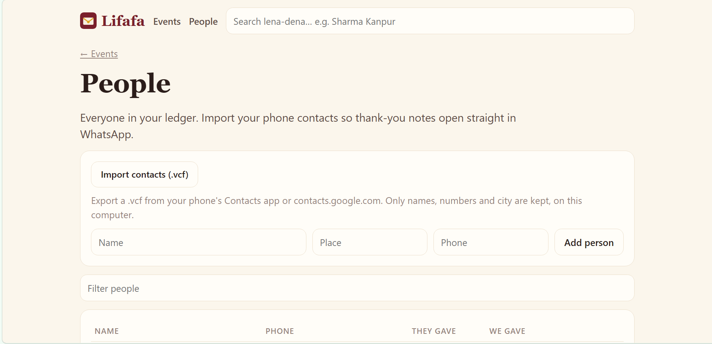

*This is a submission for the [Hacktoberfest Open-Source AI Challenge: Week 2 — Side Hustle](https://dev.to/challenges/hacktoberfest-week2-2026-10-12).*

## What I Built

At every Indian wedding there's one person at a small table with a notebook. Every time someone hands over a *lifafa* (an envelope with cash), they write it down: the name, where they're from, and the amount.

That notebook matters for years, because giving runs both ways. When that family's daughter gets married, someone in your house will ask: *"What did they give at ours? What should we give?"* That's *lena-dena*, and the answer is buried in a handwritten register in a cupboard.

**Lifafa** keeps both sides of it:

1. **Photograph a register page.** Gemma reads the handwriting on your laptop (Hindi too), checks the total, and you confirm the rows.
2. **Or just say it.** At the shagun table: *"Sharma ji Kanpur se 2100 aur chaandi ka sikka."* Lifafa reads it back, *"शर्मा जी, कानपुर से ₹2,100 और चांदी का सिक्का मिला। जोड़ दें?"*, and adds it when you say **"haan"**. It works in English, Hindi and nine more Indian languages.
3. **Record what you give back.** *"Humne Verma ji ke bete ki shaadi mein 11,000 aur ek ghadi di"* is saved as a return gift at their occasion, on the same person's page.
4. **Look anyone up.** "Sharma Kanpur" shows what they gave at your functions, what you gave at theirs, and the balance.
5. **Say thank you.** Notes in English or Hindi that never mention the amount, open straight in WhatsApp using your imported contacts, and Lifafa tracks who has been thanked.

## Who Would Pay for It

- **Families after a wedding**, with 20 pages of register, 300 thank-yous to send and a lifetime of return gifts to remember: ₹299 per event.
- **Wedding planners**, who could offer a digital shagun register with voice entry at the venue: ₹999 a year.

## Demo

Render Deployed Link[https://lifafa-7dme.onrender.com]

### Demo images: 

## Code

My Submission[https://github.com/ananya-in-tech/week-2-lifafa]

## How I Built It

Three open models and one rule: **the AI proposes, code checks, a person confirms.**

- **Whisper large-v3-turbo** (OpenAI's open-weight speech model, via faster-whisper) turns speech into text on the CPU, in Hindi, English and other Indian languages.
- **Gemma 4 (E2B)** through Ollama reads register photos (vision) and turns a spoken sentence into a structured entry.
- **Python + FastAPI + SQLite**, with a small web page and no build step.

What code checks:

- **Totals:** if the page says ₹40,802 but the rows add up to ₹40,801, you're told before saving.
- **Who gave whom:** "Neha gave" is something we received; "Humne diya" is something we gave. When the grammar is clear, code overrides the model.
- **Same person, different script:** "शर्मा जी, कानपूर" said in Hindi matches "Sharma ji, Kanpur" from the register. Lifafa romanises Devanagari and compares consonant skeletons, so it also matches लखनऊ with Lucknow and भाटिया with Bhatia, while keeping Mohan and Mahesh apart.
- **Nothing is guessed:** a missing amount, a missing occasion, or two possible Sharmas means Lifafa asks.

What went wrong along the way:

- **The model returned zero rows** from a page with six clear entries. The fields were optional in my JSON schema, so the model left the list out. Making every field required fixed it.
- **The small Whisper model got Hindi amounts wrong**: "इक्कीस सौ" (2100) became "एक की सो". The large-v3-turbo model got it right, and greedy decoding kept it at about 12 seconds per clip.
- **"हमने" became a name.** Gemma took "we" for the giver's name. A few worked examples in the prompt and a code guard fixed it.
- **"Neha gave 1100" was saved as a gift we gave.** Plain grammar rules now overrule the model when the subject is clear.
- **The same person showed up twice**: "Sharma ji" from the register and "शर्मा जी" from voice. Cross-script matching fixed it.
- **"Mohan's mundan" matched "Riya's wedding"**, because both contain "'s". A test caught it before anyone else did.

## Why Does Open Innovation Matter?

- **It's family money and family voices.** Who gave how much at your daughter's wedding, and recordings of relatives at the venue, shouldn't go to anyone's servers. Whisper and Gemma both run on the laptop. Lifafa even avoids the browser's built-in speech recognition, because that sends audio to Google.
- **It makes the price work.** A wedding means dozens of pages and hundreds of spoken entries. Paying a cloud API per page and per minute of audio would eat the margin on a ₹299 product. Local inference costs nothing.
- **I could shape it for India.** Keeping Hindi script as spoken, understanding "इक्कीस सौ" as 2100, and matching names across scripts are things I could build on open models I control.

## Prize Categories

**Best Use of Gemma:** Gemma 4 runs locally, reads every register page (vision, including Hindi handwriting) and understands spoken entries in Indian languages.
